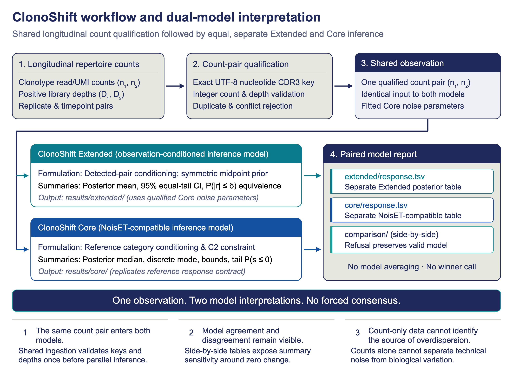
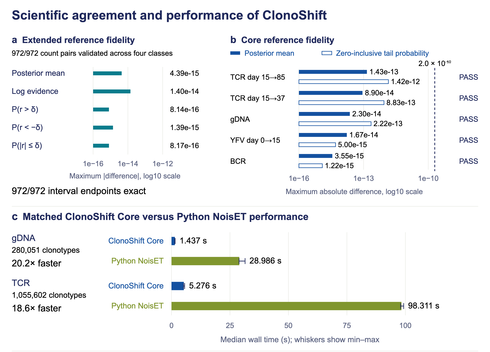

# ClonoShift

Paired longitudinal immune-repertoire inference with separate Extended and Core models.

**Version 1.0.0** · **macOS Apple Silicon** · **GPL-3.0-or-later**

[User manual](docs/ClonoShift-User-Manual.md) · [Manuscript](docs/ClonoShift-Manuscript.pdf) · [Quick start](#quick-start) · [Citation](#citation) · [License](LICENSE)

ClonoShift applies two complementary inference models to the same qualified count pairs. Extended and Core remain separate: ClonoShift does not average their outputs or choose a winner.

[](docs/images/clonoshift-workflow.png)

**Workflow.** The same qualified count pair enters Extended and Core. The models report separate summaries, with no model averaging or winner call.

## Why ClonoShift?

Repertoire counts can be sparse, sequencing depths can differ, and measurement noise can obscure longitudinal change. Model assumptions can affect the summaries; ClonoShift keeps those model-specific interpretations visible.

- Shared count qualification.
- Separate Extended and Core inference.
- Side-by-side model reporting.
- Explicit refusal safeguards.
- Reproducible Rust implementation.

Core is a NoisET-compatible Rust implementation.

## Quick Start

From the repository root, with Rust, Cargo, Ruby and a configured local dependency cache:

```bash
export CARGO_TARGET_DIR="$PWD/target"
cargo build --release --locked --offline
target/release/clonoshift --version
target/release/clonoshift legacy-poisson \
  --sample1 fixtures/synthetic/replicate1.tsv \
  --sample2 fixtures/synthetic/replicate2.tsv --output-dir fit
ruby prepare_config.rb fit/model.json hybrid.json
target/release/clonoshift analyze \
  --counts fixtures/synthetic/counts.tsv --output results \
  --config hybrid.json --model1 fit/model.json --model2 fit/model.json
cat results/comparison/run-metadata.json
```

**Expected result:** Extended and Core both report `COMPLETED`.

> **Important:** Do not reuse one fitted noise model for two biological samples unless that calibration is scientifically suitable for both.

The supplied prior is illustrative and needs scientific review for real data. Output names must be new. See the [user manual](docs/ClonoShift-User-Manual.md) for complete instructions.

## Validation and Matched Performance

[](docs/images/clonoshift-validation-performance.png)

**Validation and matched performance.** Panels A and B show numerical reference fidelity for Extended and Core. Panel C shows the matched Core-versus-Python-NoisET benchmark.

> **Benchmark scope:** The 20.2× and 18.6× ratios apply only to the matched Core benchmark. They do not compare the full Extended plus Core workflow with single-model Python NoisET.

Reference and synthetic comparisons are qualification evidence, not biological findings.

## Input

```text
ntCDR3	AACDR3	count_1	count_2
NT001	CASSF	12	18
NT002	CASRF	0	4
```

- Use tab-separated fields.
- Use unique, nonempty identifiers.
- Use nonnegative integer counts.
- Use the same biological-unit definition across samples.

See the [user manual](docs/ClonoShift-User-Manual.md) for validation and sample-merging instructions.

## Main Outputs

- `comparison/run-metadata.json`: model statuses, reasons, and settings.
- `extended/response.tsv`: Extended results.
- `core/response.tsv`: Core results.
- `comparison/summary.tsv`: descriptive side-by-side summaries.

## Reading Extended and Core

| Model | Main summaries | Interpretation |
|---|---|---|
| Extended | Posterior mean and practical-equivalence probability | Observation-conditioned estimate |
| Core | Discrete posterior median and zero-inclusive nonpositive-tail probability | NoisET-compatible estimate |

Different numerical summaries are expected. Do not average the models or select the result that better matches an expected biological story.

## Documentation

- [User manual](docs/ClonoShift-User-Manual.md)
- [Manuscript PDF](docs/ClonoShift-Manuscript.pdf)
- [Citation metadata](CITATION.cff)
- [License](LICENSE)

## Platform and Requirements

- Qualified platform: macOS on Apple Silicon.
- Rust and Cargo are required to build.
- Ruby and its JSON library are required by `prepare_config.rb`.
- The qualified offline workflow requires a local cache of the locked dependencies.

## Scientific Limits

- ClonoShift does not create a consensus biological call.
- Posterior probabilities are not p-values, and model agreement does not prove biological correctness.
- Calibration must match the assay and study design; a refusal is not a zero result.
- Count data alone cannot identify whether extra variation is technical or biological.
- Binding evidence for an assayed exact heavy/light pair must not be propagated automatically to unassayed relatives.

## Citation

See [CITATION.cff](CITATION.cff) to cite ClonoShift, NoisET and the underlying scientific methods.

## License

ClonoShift is distributed under [GPL-3.0-or-later](LICENSE).
